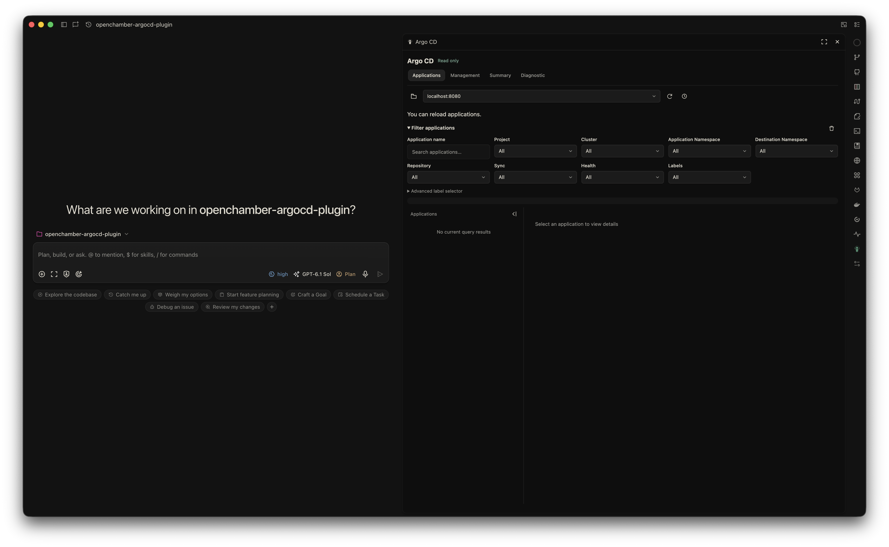

# OpenChamber Argo CD Observer

[English](README.md) | 简体中文

一个 **OpenChamber 的只读 Argo CD 扩展**。无需离开工作区，即可浏览应用、查看部署详情，以及读取资源日志和事件。

## 截图



## 功能

### Context 与应用浏览

- 读取已有 Argo CD CLI contexts，默认选中当前 context。
- 切换 context 后自动加载 Application 列表，不修改 CLI 当前 context。
- 按名称、Project、集群、应用／目标 Namespace、仓库、Sync、Health 和标签过滤应用。

### Application 配置与部署

- 查看应用来源、部署目标及单源／多源配置概览。
- 查看 Sync、Health、Conditions，以及最近一次操作的状态和资源结果。
- 浏览服务器保留的部署历史及版本信息。
- 查看期望 Manifest 与服务器缓存的 Argo Diff 结果，敏感字段会隐藏。

### 资源与工作负载详情

- 通过可搜索的资源树浏览关联资源，筛选异常节点并查看资源关系。
- 点击资源查看实时详情和 Live Manifest。
- 查看工作负载状态、Pod 就绪情况、重启次数及异常原因。

### 日志与事件

- 查看 Application 事件及所选资源的事件。
- 查看 Pod／容器日志，支持容器选择、时间过滤和行数限制。
- 按需开启日志跟随；默认仅读取有限的历史片段。

### 只读访问与集成

- 复用 OpenChamber Server 所属系统用户的 Argo CD CLI 凭据和权限。
- 不执行 Sync、回滚、删除、登录、凭据续期或 CLI 配置修改。
- 跟随 OpenChamber 的语言和主题，内置 15 种界面语言。
- 面板重新加载后可恢复按项目隔离的浏览选择、应用筛选、页签和列表布局；同项目内切换聊天共用这些状态。
- 复制内容或将摘要添加到聊天前，需预览并确认；不会自动请求模型。

## 前置条件

- **支持扩展的 OpenChamber**：扩展功能从 [v1.24.0](https://github.com/openchamber/openchamber/releases/tag/v1.24.0) 引入。本构建当前声明的安装下限为 **v2.2.0**，更早版本的兼容性尚未验证。
- **已安装并配置 Argo CD CLI**：运行 OpenChamber Server 的系统用户需已有有效凭据，以及读取所需应用、资源、日志和事件的权限。扩展直接读取这些已有配置，不执行 CLI，也无需单独登录。
- OpenChamber Server 能访问所配置的 Argo CD API。

## 安装

1. 在 OpenChamber 中打开 **设置 → 扩展**。
2. 在 **文件夹、ZIP 或 URL** 输入框中粘贴以下仓库地址，点击 **添加**：

   ```text
   https://github.com/hlhr202/OpenChamber-ArgoCD
   ```

3. 确认所请求的 Service 能力，选择 **允许并启用**。
4. 从扩展栏打开 **Argo CD**，加载已有 contexts。

无需本地构建或安装依赖。

## 隐私

- 本扩展不采集个人隐私信息，也不向开发者上报私密数据；不包含遥测、行为分析或追踪。
- 仅为访问你配置的 Argo CD API 而读取已有本地凭据，不会将凭据、应用数据、日志或事件上传至开发者或第三方的数据采集服务。
- 浏览偏好（目录、context、应用／资源标识、应用筛选、页签和布局）保存于 OpenChamber 存储：支持时保存在当前设备，否则保存在所连接的 Server。不会在其中保存凭据、查询结果、日志／事件正文或摘要预览。恢复选择后重新查询数据，日志跟随不会自动恢复。
- 将摘要加入聊天需由你明确预览并确认；若随后发送，该内容由 OpenChamber 和你选择的模型服务商按各自政策处理。

本声明仅适用于本扩展，不代表 OpenChamber、Argo CD 或模型服务商的数据处理政策。

## 许可证

[MIT](LICENSE)。捆绑依赖和 Argo 图标保留各自的许可证，详见[第三方许可证通知](THIRD_PARTY_NOTICES.txt)。
