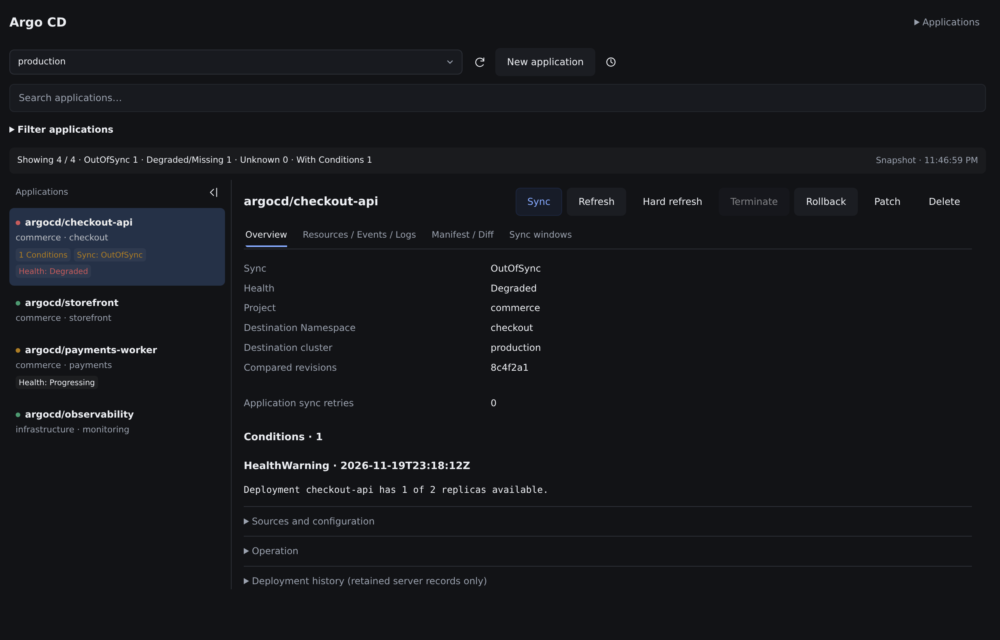
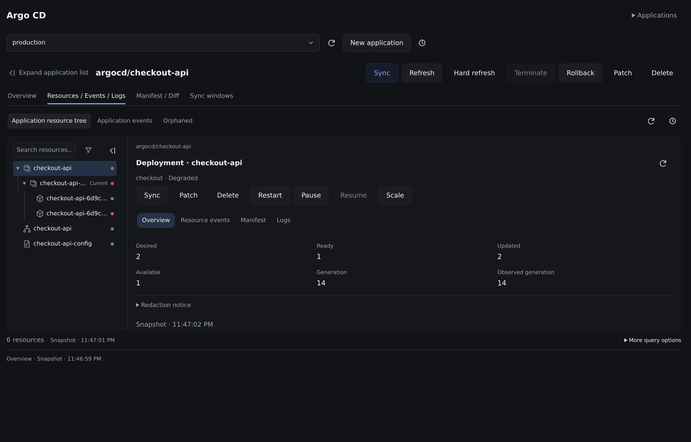

# OpenChamber Argo CD Observer

[English](../README.md) | [简体中文](README.zh-CN.md) | العربية | [Deutsch](README.de.md) | [Español](README.es.md) | [Français](README.fr.md) | [עברית](README.he.md) | [日本語](README.ja.md) | [한국어](README.ko.md) | [Nederlands](README.nl.md) | [Polski](README.pl.md) | [Português (Brasil)](README.pt-BR.md) | [Türkçe](README.tr.md) | [Українська](README.uk.md) | [繁體中文](README.zh-TW.md)

**إضافة Argo CD متكاملة المزايا لـ OpenChamber**. تصفّح التطبيقات وافحص عمليات النشر واقرأ سجلات الموارد وأحداثها ونفّذ إجراءات Argo CD التشغيلية (المزامنة والتحديث والإنهاء والتراجع وإجراءات الموارد والتعديل الجزئي والإنشاء والحذف وإجراءات الإدارة) مباشرة من مساحة عملك.

## التثبيت

1. افتح **الإعدادات ← الإضافات** في OpenChamber.
2. الصق رابط المستودع التالي في حقل **مجلد أو ZIP أو URL** وانقر على **إضافة**:

   ```text
   https://github.com/hlhr202/OpenChamber-ArgoCD
   ```

3. راجع صلاحية Service المطلوبة واختر **السماح والتفعيل**.
4. افتح **Argo CD** من شريط الإضافات وحمّل السياقات الموجودة لديك.

لا يلزم البناء محليًا أو تثبيت الاعتماديات.

يمكنك أيضًا تنزيل **openchamber-argocd.zip** من [الإصدارات](https://github.com/hlhr202/OpenChamber-ArgoCD/releases/latest) وإضافة ملف ZIP في قسم الإضافات. استخدم الحزمة الجاهزة المرفقة، وليس **Source code (zip)** الذي ينشئه GitHub.

## المتطلبات الأساسية

- **OpenChamber يدعم الإضافات**، وهي ميزة أُضيفت في [v1.24.0](https://github.com/openchamber/openchamber/releases/tag/v1.24.0). يتطلب هذا البناء حاليًا **v2.2.0 أو أحدث** للتثبيت؛ ولم يُتحقق من التوافق مع الإصدارات الأقدم.
- **تثبيت Argo CD CLI وتهيئتها مسبقًا** لمستخدم نظام التشغيل الذي يشغّل OpenChamber Server، ببيانات اعتماد صالحة وصلاحيات Argo CD RBAC لعمليات القراءة والكتابة المطلوبة. تقرأ الإضافة هذه التهيئة الموجودة وتستدعي واجهة REST الرسمية لـ Argo CD مباشرة؛ ولا تشغّل ملف CLI التنفيذي أو تسجّل الدخول بشكل منفصل.
- يجب أن يتمكن OpenChamber Server من الوصول إلى واجهة Argo CD API المهيأة.

## لقطات الشاشة

واجهة باللغة الإنجليزية مع بيانات توضيحية.

| نظرة عامة على التطبيقات والإجراءات | نافذة مزامنة التطبيق |
| :---: | :---: |
|  |  |
| **شجرة الموارد وإجراءات الموارد** | **الإدارة (المشاريع والمجموعات والمستودعات)** |
|  |  |

## الميزات

- تبديل سياقات Argo CD والبحث عن التطبيقات وتصفيتها.
- فحص تهيئة التطبيقات وحالتها وسجل عمليات النشر وأشجار الموارد.
- قراءة سجلات وحدات Pod والحاويات والأحداث وملفات Manifest والفروق.
- تنفيذ إجراءات Argo CD التشغيلية (مفعّلة افتراضياً وتخضع لصلاحيات RBAC ونوافذ المزامنة في Argo CD) وفق نموذج [Argo CD CLI](https://github.com/argoproj/argo-cd) الرسمي: المزامنة (مع Prune وDry-Run وForce وReplace وServer-Side Apply وتحديد الموارد)، والتحديث العادي والقسري، وإنهاء العمليات، والتراجع (Rollback)، وإجراءات الموارد (V2 مع رجوع تلقائي إلى V1)، والتعديل الجزئي (Patch)، وإنشاء/حذف التطبيقات والموارد، وإدارة ApplicationSet والمشاريع والمستودعات والعناقيد.
- معاينة ملخصات استكشاف الأخطاء وتأكيدها قبل إضافتها إلى المحادثة.
- تتبع لغة OpenChamber ومظهره عبر 15 لغة.

## الخصوصية

- لا تجمع هذه الإضافة معلومات شخصية ولا ترسل بيانات خاصة إلى مطوريها. ولا تحتوي على قياس عن بُعد أو تحليلات أو تتبّع.
- تُقرأ بيانات الاعتماد المحلية الموجودة فقط لمصادقة الطلبات إلى واجهة Argo CD API التي هيأتها. ولا تُرفع بيانات الاعتماد أو بيانات التطبيقات أو السجلات أو الأحداث إلى خدمات جمع بيانات يديرها المطورون أو أطراف ثالثة.
- تُحفظ تفضيلات التصفح (الدليل والسياق ومعرّفات التطبيقات والموارد ومرشحات التطبيقات وعلامات التبويب والتخطيط) في تخزين OpenChamber: على هذا الجهاز عند دعمه، وإلا فعلى Server المتصل. لا تُحفظ فيه بيانات الاعتماد أو نتائج الاستعلامات أو محتويات السجلات والأحداث أو معاينات الملخصات. تستعلم استعادة الاختيارات عن البيانات مجددًا؛ ولا تُستأنف متابعة السجلات تلقائيًا أبدًا.
- تتطلب إضافة ملخص إلى المحادثة معاينتك وتأكيدك الصريحين. وإذا أرسلته لاحقًا، يعالج OpenChamber ومزوّد النموذج الذي تختاره المحتوى وفق سياساتهما الخاصة.

يخص هذا البيان هذه الإضافة فقط، ولا يشمل ممارسات البيانات لدى OpenChamber أو Argo CD أو مزوّدي النماذج.

## الترخيص

[MIT](../LICENSE). تحتفظ الاعتماديات المضمّنة وأيقونة Argo بتراخيصها الخاصة؛ راجع [إشعارات الجهات الخارجية](../THIRD_PARTY_NOTICES.txt).
