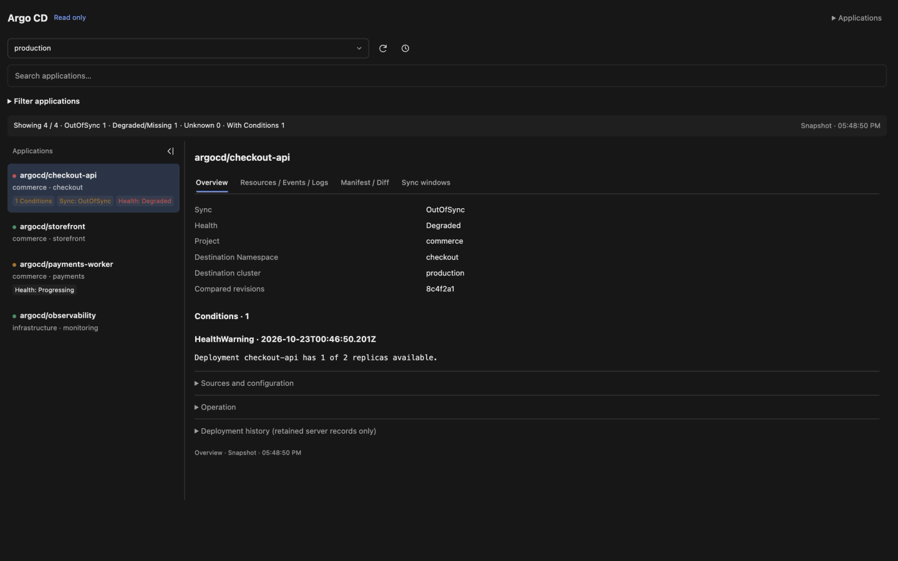
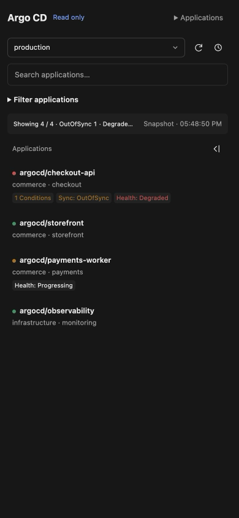

# OpenChamber Argo CD Observer

[English](../README.md) | [简体中文](README.zh-CN.md) | [العربية](README.ar.md) | Deutsch | [Español](README.es.md) | [Français](README.fr.md) | [עברית](README.he.md) | [日本語](README.ja.md) | [한국어](README.ko.md) | [Nederlands](README.nl.md) | [Polski](README.pl.md) | [Português (Brasil)](README.pt-BR.md) | [Türkçe](README.tr.md) | [Українська](README.uk.md) | [繁體中文](README.zh-TW.md)

Eine **vollwertige Argo-CD-Erweiterung für OpenChamber**. Anwendungen durchsuchen, Deployments prüfen, Ressourcenprotokolle und Ereignisse lesen sowie operative Argo-CD-Aktionen (Sync, Refresh, Terminate, Rollback, Resource Actions, Patch, Erstellen, Löschen und Verwaltungsoperationen) direkt im Arbeitsbereich ausführen.

## Installation

1. In OpenChamber **Einstellungen → Erweiterungen** öffnen.
2. Diese Repository-URL unter **Ordner, ZIP oder URL** einfügen und auf **Hinzufügen** klicken:

   ```text
   https://github.com/hlhr202/OpenChamber-ArgoCD
   ```

3. Die angeforderte Service-Berechtigung prüfen und **Erlauben und aktivieren** wählen.
4. **Argo CD** in der Erweiterungsleiste öffnen und die vorhandenen Kontexte laden.

Weder ein lokaler Build noch eine Installation von Abhängigkeiten ist erforderlich.

Alternativ **openchamber-argocd.zip** aus den [Releases](https://github.com/hlhr202/OpenChamber-ArgoCD/releases/latest) herunterladen und diese ZIP-Datei unter Erweiterungen hinzufügen. Das angehängte vorgefertigte ZIP verwenden, nicht GitHubs **Source code (zip)**.

## Voraussetzungen

- **OpenChamber mit Erweiterungsunterstützung**, eingeführt in [v1.24.0](https://github.com/openchamber/openchamber/releases/tag/v1.24.0). Dieser Build setzt für die Installation derzeit **v2.2.0 oder neuer** voraus; die Kompatibilität mit älteren Versionen ist nicht geprüft.
- **Argo CD CLI installiert und bereits konfiguriert** für den Betriebssystembenutzer, unter dem OpenChamber Server läuft, mit gültigen Zugangsdaten und Argo-CD-RBAC-Berechtigungen für die benötigten Lese- und Schreiboperationen. Die Erweiterung liest diese Konfiguration und ruft die offizielle Argo-CD-REST-API direkt auf; sie führt die CLI nicht aus und meldet sich nicht separat an.
- OpenChamber Server muss die konfigurierte Argo CD API erreichen können.

## Screenshots

Englische Oberfläche mit Beispieldaten.

**Desktop — Anwendungsliste und Übersicht**



**Mobilgerät — Anwendungsliste**



## Funktionen

- Argo-CD-Kontexte wechseln und Anwendungen suchen oder filtern.
- Anwendungskonfiguration, Status, Deployment-Verlauf und Ressourcenbäume prüfen.
- Pod-/Container-Protokolle, Ereignisse, Manifeste und Diffs lesen.
- Operative Argo-CD-Aktionen ausführen (standardmäßig aktiviert, gesteuert durch Argo-CD-RBAC und Sync Windows), angelehnt an die offizielle [Argo CD CLI](https://github.com/argoproj/argo-cd): Sync (mit Prune, Dry-Run, Force, Replace, Server-Side Apply, selektiven Ressourcen), Refresh / Hard Refresh, Terminate, Rollback, Resource Actions (V2 mit automatischem V1-Fallback), Patch, Erstellen/Löschen von Anwendungen und Ressourcen sowie ApplicationSet-/Projekt-/Repository-/Cluster-Aktionen.
- Diagnosezusammenfassungen vorab ansehen und erst nach Bestätigung zum Chat hinzufügen.
- Folgt Sprache und Design von OpenChamber in 15 Sprachen.

## Datenschutz

- Diese Erweiterung erhebt keine personenbezogenen Daten und meldet keine privaten Daten an ihre Entwickler. Sie enthält keine Telemetrie, Analyse oder Nachverfolgung.
- Vorhandene lokale Zugangsdaten werden nur zur Authentifizierung von Anfragen an die konfigurierte Argo CD API gelesen. Zugangsdaten, Anwendungsdaten, Protokolle und Ereignisse werden nicht an Datensammlungsdienste der Entwickler oder Dritter hochgeladen.
- Navigationseinstellungen (Verzeichnis, Kontext, Anwendungs-/Ressourcenkennungen, Anwendungsfilter, Tabs und Layout) werden im OpenChamber-Speicher abgelegt: wenn unterstützt auf diesem Gerät, andernfalls auf dem verbundenen Server. Zugangsdaten, Abfrageergebnisse, Protokoll-/Ereignisinhalte und Zusammenfassungsvorschauen werden dort nicht gespeichert. Wiederhergestellte Auswahlen laden Daten erneut; das fortlaufende Lesen von Protokollen wird nie automatisch fortgesetzt.
- Das Hinzufügen einer Zusammenfassung zum Chat erfordert Ihre ausdrückliche Vorschau und Bestätigung. Wenn Sie sie anschließend senden, verarbeiten OpenChamber und der gewählte Modellanbieter den Inhalt gemäß ihren eigenen Richtlinien.

Diese Erklärung gilt nur für diese Erweiterung, nicht für die Datenverarbeitung von OpenChamber, Argo CD oder Modellanbietern.

## Lizenz

[MIT](../LICENSE). Gebündelte Abhängigkeiten und das Argo-Symbol behalten ihre jeweiligen Lizenzen; siehe [Drittanbieterhinweise](../THIRD_PARTY_NOTICES.txt).
