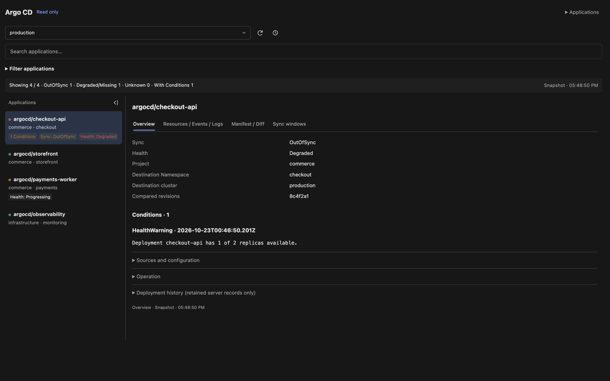
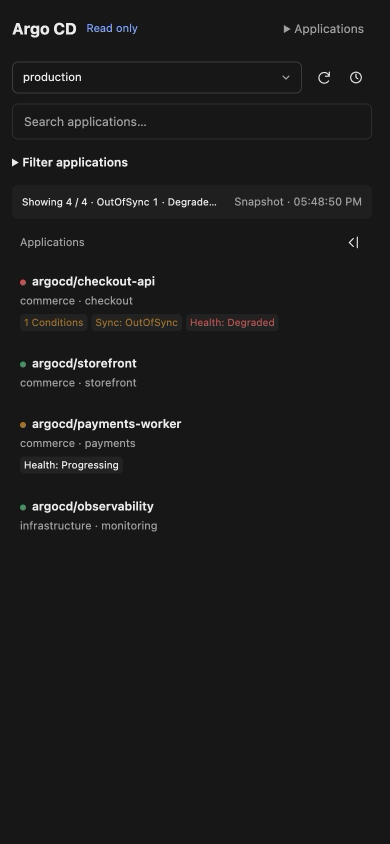

# OpenChamber Argo CD Observer

[English](../README.md) | [简体中文](README.zh-CN.md) | [العربية](README.ar.md) | [Deutsch](README.de.md) | [Español](README.es.md) | Français | [עברית](README.he.md) | [日本語](README.ja.md) | [한국어](README.ko.md) | [Nederlands](README.nl.md) | [Polski](README.pl.md) | [Português (Brasil)](README.pt-BR.md) | [Türkçe](README.tr.md) | [Українська](README.uk.md) | [繁體中文](README.zh-TW.md)

Une **extension Argo CD en lecture seule pour OpenChamber**. Parcourez les applications, inspectez les déploiements et consultez les journaux et événements des ressources sans quitter votre espace de travail.

## Installation

1. Dans OpenChamber, ouvrez **Paramètres → Extensions**.
2. Collez cette URL de dépôt dans **Dossier, ZIP ou URL**, puis cliquez sur **Ajouter** :

   ```text
   https://github.com/hlhr202/OpenChamber-ArgoCD
   ```

3. Vérifiez la capacité Service demandée et choisissez **Autoriser et activer**.
4. Ouvrez **Argo CD** dans la barre des extensions et chargez vos contextes.

Aucune compilation locale ni installation de dépendances n'est nécessaire.

Vous pouvez aussi télécharger **openchamber-argocd.zip** depuis les [Releases](https://github.com/hlhr202/OpenChamber-ArgoCD/releases/latest) et ajouter ce ZIP dans Extensions. Utilisez le ZIP précompilé joint, pas **Source code (zip)** de GitHub.

## Prérequis

- **OpenChamber avec prise en charge des extensions**, introduite dans [v1.24.0](https://github.com/openchamber/openchamber/releases/tag/v1.24.0). Cette version exige actuellement **v2.2.0 ou ultérieure** pour l'installation ; la compatibilité avec les versions antérieures n'est pas vérifiée.
- **CLI Argo CD installée et déjà configurée** pour l'utilisateur système exécutant OpenChamber Server, avec des identifiants valides et les droits de lecture des applications, ressources, journaux et événements nécessaires. L'extension lit cette configuration ; elle n'exécute pas la CLI et ne se connecte pas séparément.
- OpenChamber Server doit pouvoir accéder à l'API Argo CD configurée.

## Captures d'écran

Interface en anglais avec des données d'exemple.

**Ordinateur — liste des applications et vue d'ensemble**



**Mobile — liste des applications**



## Fonctionnalités

- Changer de contexte Argo CD, rechercher et filtrer les applications.
- Examiner la configuration, l'état, l'historique des déploiements et les arborescences de ressources.
- Lire les journaux des Pods/conteneurs, les événements, les manifestes et les différences.
- Prévisualiser les résumés de diagnostic et confirmer avant de les ajouter au chat.
- Lecture seule par conception, avec la langue et le thème d'OpenChamber.

## Confidentialité

- Cette extension ne collecte aucune information personnelle et ne transmet aucune donnée privée à ses développeurs. Elle ne contient ni télémétrie, ni analyse, ni suivi.
- Les identifiants locaux existants sont lus uniquement pour authentifier les requêtes vers votre API Argo CD configurée. Les identifiants, données d'application, journaux et événements ne sont pas envoyés à des services de collecte des développeurs ou de tiers.
- Les préférences de navigation (répertoire, contexte, identifiants d'application/ressource, filtres, onglets et disposition) sont enregistrées dans le stockage OpenChamber : sur cet appareil si possible, sinon sur le Server connecté. Les identifiants, résultats de requêtes, contenus des journaux/événements et aperçus des résumés n'y sont pas enregistrés. Restaurer une sélection relance les requêtes ; le suivi des journaux ne reprend jamais automatiquement.
- Ajouter un résumé au chat exige votre prévisualisation et votre confirmation explicites. Si vous l'envoyez ensuite, OpenChamber et le fournisseur de modèle choisi traitent ce contenu selon leurs propres politiques.

Cette déclaration concerne uniquement cette extension, et non les pratiques d'OpenChamber, d'Argo CD ou des fournisseurs de modèles.

## Licence

[MIT](../LICENSE). Les dépendances incluses et l'icône Argo conservent leurs licences respectives ; voir les [mentions tierces](../THIRD_PARTY_NOTICES.txt).
