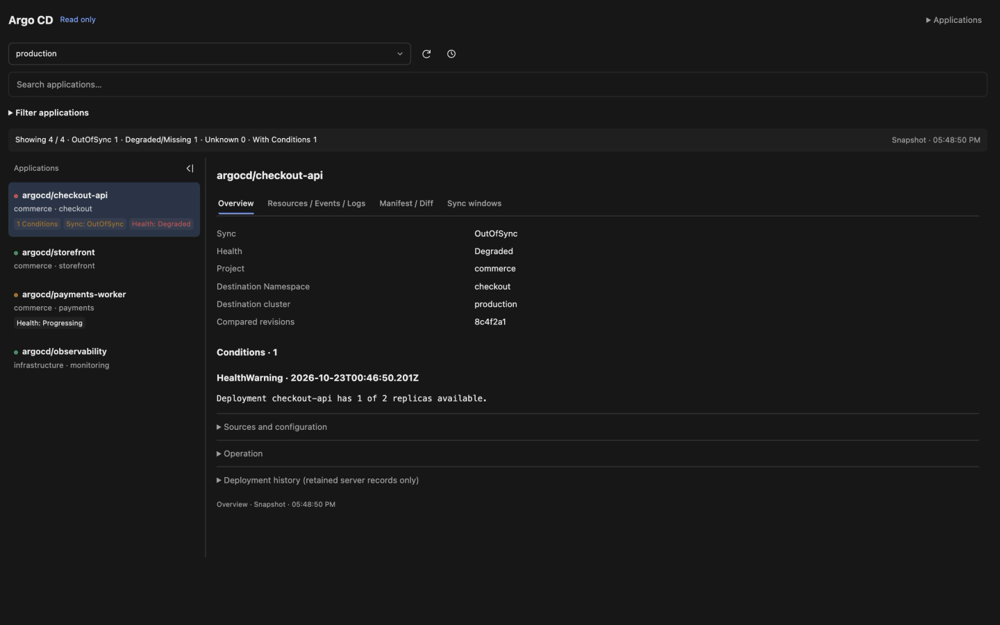
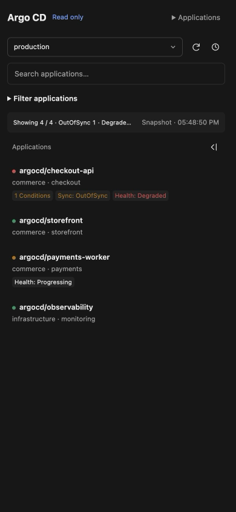

# OpenChamber Argo CD Observer

[English](../README.md) | [简体中文](README.zh-CN.md) | [العربية](README.ar.md) | [Deutsch](README.de.md) | [Español](README.es.md) | [Français](README.fr.md) | עברית | [日本語](README.ja.md) | [한국어](README.ko.md) | [Nederlands](README.nl.md) | [Polski](README.pl.md) | [Português (Brasil)](README.pt-BR.md) | [Türkçe](README.tr.md) | [Українська](README.uk.md) | [繁體中文](README.zh-TW.md)

**הרחבת Argo CD מלאה עבור OpenChamber**. עיינו ביישומים, בדקו פריסות, קראו יומנים ואירועים של משאבים ובצעו פעולות תפעוליות של Argo CD (סנכרון, רענון, הפסקה, שחזור, פעולות משאב, טלאי, יצירה, מחיקה וניהול) ישירות מסביבת העבודה.

## התקנה

1. פתחו את **הגדרות ← הרחבות** ב־OpenChamber.
2. הדביקו את כתובת המאגר הבאה בשדה **תיקייה, ZIP או URL** ולחצו על **הוספה**:

   ```text
   https://github.com/hlhr202/OpenChamber-ArgoCD
   ```

3. בדקו את יכולת ה־Service המבוקשת ובחרו **אישור והפעלה**.
4. פתחו את **Argo CD** מסרגל ההרחבות וטענו את ההקשרים הקיימים שלכם.

אין צורך בבנייה מקומית או בהתקנת תלויות.

אפשר גם להוריד את **openchamber-argocd.zip** מתוך [Releases](https://github.com/hlhr202/OpenChamber-ArgoCD/releases/latest) ולהוסיף את ה־ZIP בהרחבות. השתמשו בקובץ המוכן המצורף, ולא ב־**Source code (zip)** של GitHub.

## דרישות מקדימות

- **OpenChamber עם תמיכה בהרחבות**, שנוספה ב־[v1.24.0](https://github.com/openchamber/openchamber/releases/tag/v1.24.0). גרסה זו דורשת כעת **v2.2.0 ומעלה** להתקנה; התאימות לגרסאות ישנות יותר לא אומתה.
- **Argo CD CLI מותקן ומוגדר מראש** עבור משתמש מערכת ההפעלה שמריץ את OpenChamber Server, עם פרטי אימות תקפים והרשאות RBAC של Argo CD לפעולות הקריאה והכתיבה הנדרשות. ההרחבה קוראת את התצורה הקיימת ופונה ישירות ל־REST API הרשמי של Argo CD; היא אינה מפעילה את קובץ ה־CLI ואינה מבצעת התחברות נפרדת.
- ל־OpenChamber Server חייבת להיות גישה ל־Argo CD API שהוגדר.

## צילומי מסך

ממשק באנגלית עם נתונים לדוגמה.

**מחשב — רשימת יישומים וסקירה כללית**



**נייד — רשימת יישומים**



## יכולות

- מעבר בין הקשרי Argo CD וחיפוש או סינון יישומים.
- בדיקת תצורת יישומים, מצב, היסטוריית פריסות ועצי משאבים.
- קריאת יומני Pods ומכולות, אירועים, מניפסטים והבדלים.
- ביצוע פעולות תפעוליות של Argo CD (פעיל כברירת מחדל ובכפוף להרשאות RBAC וחלונות סנכרון של Argo CD) בהתאם ל־[Argo CD CLI](https://github.com/argoproj/argo-cd) הרשמי: סנכרון (כולל Prune, Dry-Run, Force, Replace, Server-Side Apply ומשאבים נבחרים), רענון ורענון קשיח, הפסקת פעולה, שחזור (Rollback), פעולות משאב (V2 עם נסיגה אוטומטית ל־V1), טלאי (Patch), יצירה/מחיקה של יישומים ומשאבים, וניהול ApplicationSet, פרויקטים, מאגרים ואשכולות.
- תצוגה מקדימה של סיכומי אבחון ואישור לפני הוספתם לצ'אט.
- מותאם לשפה ולערכת הנושא של OpenChamber ב־15 שפות.

## פרטיות

- הרחבה זו אינה אוספת מידע אישי ואינה מדווחת נתונים פרטיים למפתחיה. היא אינה כוללת טלמטריה, ניתוח נתונים או מעקב.
- פרטי אימות מקומיים קיימים נקראים רק כדי לאמת בקשות ל־Argo CD API שהגדרתם. פרטי אימות, נתוני יישומים, יומנים ואירועים אינם מועלים לשירותי איסוף נתונים של המפתחים או של צדדים שלישיים.
- העדפות גלישה (תיקייה, הקשר, מזהי יישומים ומשאבים, מסנני יישומים, לשוניות ופריסה) נשמרות באחסון של OpenChamber: במכשיר זה אם הדבר נתמך, ואחרת ב־Server המחובר. פרטי אימות, תוצאות שאילתות, תוכן יומנים ואירועים ותצוגות מקדימות של סיכומים אינם נשמרים שם. שחזור בחירות מבצע שאילתות מחדש; מעקב רציף אחר יומנים לעולם אינו מתחדש אוטומטית.
- הוספת סיכום לצ'אט מחייבת תצוגה מקדימה ואישור מפורש שלכם. אם תשלחו אותו בהמשך, OpenChamber וספק המודל שבחרתם יעבדו את התוכן בהתאם למדיניות שלהם.

הצהרה זו חלה רק על הרחבה זו, ולא על נוהלי הנתונים של OpenChamber, Argo CD או ספקי מודלים.

## רישיון

[MIT](../LICENSE). התלויות הכלולות וסמל Argo שומרים על הרישיונות שלהם; ראו [הודעות צד שלישי](../THIRD_PARTY_NOTICES.txt).
