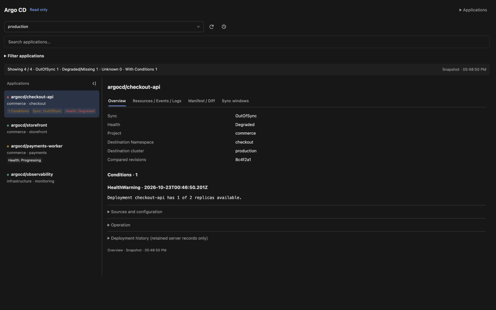
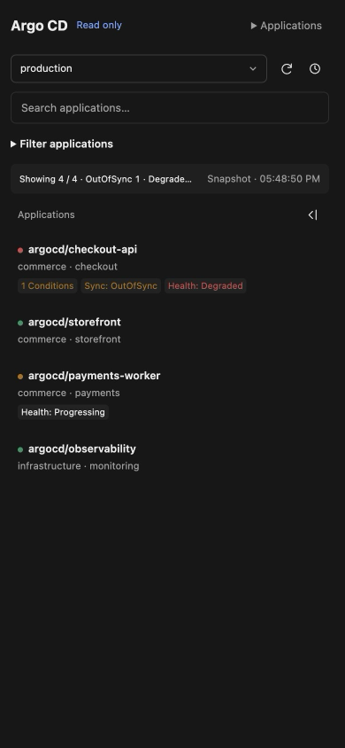

# OpenChamber Argo CD Observer

[English](../README.md) | [简体中文](README.zh-CN.md) | [العربية](README.ar.md) | [Deutsch](README.de.md) | [Español](README.es.md) | [Français](README.fr.md) | [עברית](README.he.md) | [日本語](README.ja.md) | [한국어](README.ko.md) | Nederlands | [Polski](README.pl.md) | [Português (Brasil)](README.pt-BR.md) | [Türkçe](README.tr.md) | [Українська](README.uk.md) | [繁體中文](README.zh-TW.md)

Een **volledige Argo CD-extensie voor OpenChamber**. Blader door applicaties, inspecteer deployments, lees resourcelogboeken en gebeurtenissen en voer operationele Argo CD-acties (Sync, Refresh, Terminate, Rollback, Resource Actions, Patch, aanmaken, verwijderen en beheeracties) rechtstreeks vanuit uw werkruimte uit.

## Installatie

1. Open **Instellingen → Extensies** in OpenChamber.
2. Plak deze repository-URL in **Map, ZIP of URL** en klik op **Toevoegen**:

   ```text
   https://github.com/hlhr202/OpenChamber-ArgoCD
   ```

3. Controleer de gevraagde Service-mogelijkheid en kies **Toestaan en inschakelen**.
4. Open **Argo CD** vanuit de extensiebalk en laad uw contexten.

Lokaal bouwen of afhankelijkheden installeren is niet nodig.

U kunt ook **openchamber-argocd.zip** downloaden uit de [Releases](https://github.com/hlhr202/OpenChamber-ArgoCD/releases/latest) en die ZIP toevoegen bij Extensies. Gebruik de bijgevoegde vooraf gebouwde ZIP, niet GitHubs **Source code (zip)**.

## Vereisten

- **OpenChamber met extensieondersteuning**, geïntroduceerd in [v1.24.0](https://github.com/openchamber/openchamber/releases/tag/v1.24.0). Deze build vereist momenteel **v2.2.0 of nieuwer** voor installatie; compatibiliteit met oudere versies is niet geverifieerd.
- **Argo CD CLI geïnstalleerd en al geconfigureerd** voor de systeemgebruiker die OpenChamber Server uitvoert, met geldige aanmeldgegevens en Argo CD RBAC-rechten voor de vereiste lees- en schrijfbewerkingen. De extensie leest deze configuratie en roept rechtstreeks de officiële REST API van Argo CD aan; ze voert de CLI niet uit en meldt zich niet apart aan.
- OpenChamber Server moet de geconfigureerde Argo CD API kunnen bereiken.

## Schermafbeeldingen

Engelstalige interface met voorbeeldgegevens.

**Desktop — applicatielijst en overzicht**



**Mobiel — applicatielijst**



## Functies

- Wissel tussen Argo CD-contexten en zoek of filter applicaties.
- Inspecteer applicatieconfiguratie, status, deploymentgeschiedenis en resourcebomen.
- Lees Pod-/containerlogboeken, gebeurtenissen, manifesten en verschillen.
- Operationele Argo CD-acties uitvoeren (standaard ingeschakeld, beheerd via Argo CD RBAC en Sync Windows), gemodelleerd naar de officiële [Argo CD CLI](https://github.com/argoproj/argo-cd): Sync (met Prune, Dry-Run, Force, Replace, Server-Side Apply en selectieve resources), Refresh / Hard Refresh, Terminate, Rollback, Resource Actions (V2 met automatische V1-terugval), Patch, applicaties en resources aanmaken/verwijderen en ApplicationSet-/Project-/repository-/clusterbeheer.
- Bekijk probleemoplossingssamenvattingen vooraf en bevestig voordat ze aan de chat worden toegevoegd.
- Volgt de taal en het thema van OpenChamber in 15 talen.

## Privacy

- Deze extensie verzamelt geen persoonsgegevens en meldt geen privégegevens aan de ontwikkelaars. Ze bevat geen telemetrie, analyses of tracking.
- Bestaande lokale aanmeldgegevens worden alleen gelezen om verzoeken aan uw geconfigureerde Argo CD API te authenticeren. Aanmeldgegevens, applicatiegegevens, logboeken en gebeurtenissen worden niet geüpload naar gegevensverzameldiensten van ontwikkelaars of derden.
- Navigatievoorkeuren (map, context, applicatie-/resource-ID's, applicatiefilters, tabbladen en indeling) worden opgeslagen in OpenChamber-opslag: op dit apparaat indien ondersteund, anders op de verbonden Server. Aanmeldgegevens, queryresultaten, inhoud van logboeken/gebeurtenissen en samenvattingsvoorbeelden worden daar niet opgeslagen. Herstelde selecties vragen gegevens opnieuw op; het volgen van logboeken wordt nooit automatisch hervat.
- Een samenvatting aan de chat toevoegen vereist uw expliciete voorvertoning en bevestiging. Als u die daarna verzendt, verwerken OpenChamber en uw gekozen modelaanbieder de inhoud volgens hun eigen beleid.

Deze verklaring betreft alleen deze extensie, niet het gegevensbeleid van OpenChamber, Argo CD of modelaanbieders.

## Licentie

[MIT](../LICENSE). Gebundelde afhankelijkheden en het Argo-pictogram behouden hun eigen licenties; zie [kennisgevingen van derden](../THIRD_PARTY_NOTICES.txt).
