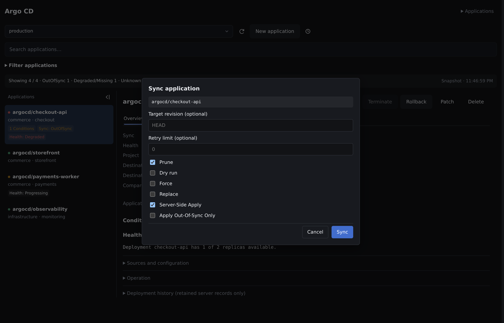

# OpenChamber Argo CD Observer

[English](../README.md) | [简体中文](README.zh-CN.md) | [العربية](README.ar.md) | [Deutsch](README.de.md) | [Español](README.es.md) | [Français](README.fr.md) | [עברית](README.he.md) | [日本語](README.ja.md) | [한국어](README.ko.md) | [Nederlands](README.nl.md) | Polski | [Português (Brasil)](README.pt-BR.md) | [Türkçe](README.tr.md) | [Українська](README.uk.md) | [繁體中文](README.zh-TW.md)

**Pełnofunkcyjne rozszerzenie Argo CD dla OpenChamber**. Przeglądaj aplikacje, sprawdzaj wdrożenia, czytaj logi i zdarzenia zasobów oraz wykonuj operacje Argo CD (Sync, Refresh, Terminate, Rollback, Resource Actions, Patch, tworzenie, usuwanie i operacje zarządzania) bezpośrednio z obszaru roboczego.

## Instalacja

1. Otwórz **Ustawienia → Rozszerzenia** w OpenChamber.
2. Wklej ten adres repozytorium w polu **Folder, ZIP lub URL** i kliknij **Dodaj**:

   ```text
   https://github.com/hlhr202/OpenChamber-ArgoCD
   ```

3. Sprawdź żądaną możliwość Service i wybierz **Zezwól i włącz**.
4. Otwórz **Argo CD** na pasku rozszerzeń i załaduj swoje konteksty.

Lokalne budowanie ani instalowanie zależności nie jest wymagane.

Możesz też pobrać **openchamber-argocd.zip** z [Releases](https://github.com/hlhr202/OpenChamber-ArgoCD/releases/latest) i dodać ten ZIP w rozszerzeniach. Użyj załączonego gotowego archiwum, a nie **Source code (zip)** z GitHub.

## Wymagania

- **OpenChamber z obsługą rozszerzeń**, wprowadzoną w [v1.24.0](https://github.com/openchamber/openchamber/releases/tag/v1.24.0). Ta kompilacja wymaga obecnie do instalacji **v2.2.0 lub nowszej**; zgodność ze starszymi wersjami nie została zweryfikowana.
- **Argo CD CLI zainstalowane i skonfigurowane** dla użytkownika systemowego uruchamiającego OpenChamber Server, z ważnymi danymi uwierzytelniającymi i uprawnieniami RBAC Argo CD do wymaganych operacji odczytu i zapisu. Rozszerzenie odczytuje tę konfigurację i wywołuje bezpośrednio oficjalne REST API Argo CD; nie uruchamia CLI ani nie loguje się osobno.
- OpenChamber Server musi mieć dostęp do skonfigurowanego API Argo CD.

## Zrzuty ekranu

Interfejs angielski z przykładowymi danymi.

| Przegląd aplikacji i akcje | Okno synchronizacji aplikacji |
| :---: | :---: |
|  |  |
| **Drzewo zasobów i akcje zasobów** | **Zarządzanie (Projekty, Klastry, Repozytoria)** |
|  |  |

## Funkcje

- Przełączanie kontekstów Argo CD oraz wyszukiwanie i filtrowanie aplikacji.
- Przeglądanie konfiguracji, stanu, historii wdrożeń i drzew zasobów.
- Odczyt logów Podów/kontenerów, zdarzeń, manifestów i różnic.
- Wykonywanie operacji Argo CD (domyślnie włączone, kontrolowane przez RBAC i Sync Windows Argo CD), wzorowanych na oficjalnym [Argo CD CLI](https://github.com/argoproj/argo-cd): Sync (z Prune, Dry-Run, Force, Replace, Server-Side Apply i wyborem zasobów), Refresh / Hard Refresh, przerywanie operacji, Rollback, Resource Actions (V2 z automatycznym powrotem do V1), Patch, tworzenie/usuwanie aplikacji i zasobów oraz zarządzanie ApplicationSet/Project/repozytoriami/klastrami.
- Podgląd podsumowań diagnostycznych i potwierdzenie przed dodaniem do czatu.
- Zgodność z językiem i motywem OpenChamber w 15 wersjach językowych.

## Prywatność

- Rozszerzenie nie zbiera danych osobowych ani nie przekazuje prywatnych danych programistom. Nie zawiera telemetrii, analityki ani śledzenia.
- Istniejące lokalne dane uwierzytelniające są odczytywane wyłącznie do uwierzytelniania żądań do skonfigurowanego API Argo CD. Dane uwierzytelniające, dane aplikacji, logi i zdarzenia nie są wysyłane do usług gromadzenia danych programistów ani osób trzecich.
- Preferencje przeglądania (katalog, kontekst, identyfikatory aplikacji/zasobów, filtry, karty i układ) są zapisywane w pamięci OpenChamber: na tym urządzeniu, jeśli jest to obsługiwane, w przeciwnym razie na połączonym Server. Dane uwierzytelniające, wyniki zapytań, treść logów/zdarzeń i podglądy podsumowań nie są tam zapisywane. Przywrócenie wyboru ponownie pobiera dane; śledzenie logów nigdy nie wznawia się automatycznie.
- Dodanie podsumowania do czatu wymaga jego wyraźnego podglądu i potwierdzenia przez użytkownika. Jeśli później je wyślesz, OpenChamber i wybrany dostawca modelu przetworzą treść zgodnie z własnymi zasadami.

Oświadczenie dotyczy wyłącznie tego rozszerzenia, a nie zasad przetwarzania danych OpenChamber, Argo CD ani dostawców modeli.

## Licencja

[MIT](../LICENSE). Dołączone zależności i ikona Argo zachowują własne licencje; zobacz [informacje o podmiotach trzecich](../THIRD_PARTY_NOTICES.txt).
