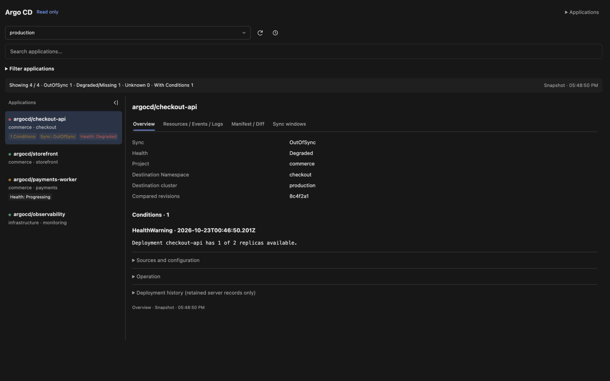
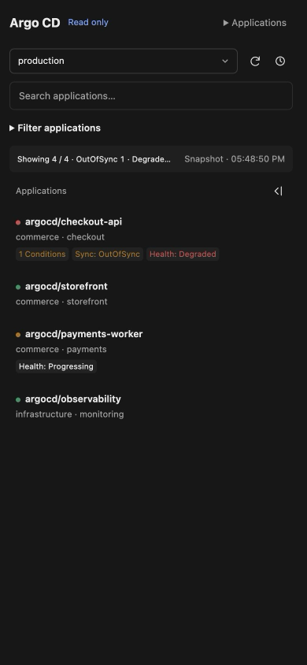

# OpenChamber Argo CD Observer

[English](../README.md) | [简体中文](README.zh-CN.md) | [العربية](README.ar.md) | [Deutsch](README.de.md) | [Español](README.es.md) | [Français](README.fr.md) | [עברית](README.he.md) | [日本語](README.ja.md) | [한국어](README.ko.md) | [Nederlands](README.nl.md) | [Polski](README.pl.md) | [Português (Brasil)](README.pt-BR.md) | [Türkçe](README.tr.md) | Українська | [繁體中文](README.zh-TW.md)

**Повнофункціональне розширення Argo CD для OpenChamber**. Переглядайте застосунки, інспектуйте розгортання, читайте журнали й події ресурсів та виконуйте операційні дії Argo CD (Sync, Refresh, Terminate, Rollback, Resource Actions, Patch, створення, видалення та керування) безпосередньо у робочому просторі.

## Встановлення

1. Відкрийте **Налаштування → Розширення** в OpenChamber.
2. Вставте цю URL-адресу репозиторію в поле **Папка, ZIP або URL** і натисніть **Додати**:

   ```text
   https://github.com/hlhr202/OpenChamber-ArgoCD
   ```

3. Перевірте запитану можливість Service і виберіть **Дозволити й увімкнути**.
4. Відкрийте **Argo CD** на панелі розширень і завантажте свої контексти.

Локальне збирання та встановлення залежностей не потрібні.

Також можна завантажити **openchamber-argocd.zip** із [Releases](https://github.com/hlhr202/OpenChamber-ArgoCD/releases/latest) і додати цей ZIP у розділі розширень. Використовуйте прикріплений готовий ZIP, а не **Source code (zip)** від GitHub.

## Передумови

- **OpenChamber із підтримкою розширень**, запровадженою у [v1.24.0](https://github.com/openchamber/openchamber/releases/tag/v1.24.0). Поточна збірка вимагає для встановлення **v2.2.0 або новішу**; сумісність зі старішими версіями не перевірено.
- **Argo CD CLI встановлено й налаштовано** для системного користувача, який запускає OpenChamber Server, із чинними обліковими даними та правами RBAC Argo CD для потрібних операцій читання й запису. Розширення читає наявну конфігурацію та викликає офіційний REST API Argo CD напряму; воно не запускає CLI й не виконує окремий вхід.
- OpenChamber Server повинен мати доступ до налаштованого API Argo CD.

## Знімки екрана

Англомовний інтерфейс із демонстраційними даними.

**Комп'ютер — список застосунків і огляд**



**Мобільний пристрій — список застосунків**



## Можливості

- Перемикання контекстів Argo CD, пошук і фільтрування застосунків.
- Перегляд конфігурації, стану, історії розгортань і дерев ресурсів.
- Читання журналів Pod/контейнерів, подій, маніфестів і відмінностей.
- Виконання операційних дій Argo CD (увімкнено за замовчуванням, контролюється RBAC і Sync Windows Argo CD) за зразком офіційного [Argo CD CLI](https://github.com/argoproj/argo-cd): Sync (із Prune, Dry-Run, Force, Replace, Server-Side Apply, вибором ресурсів), Refresh / Hard Refresh, переривання операції, Rollback, Resource Actions (V2 з автоматичним відкатом до V1), Patch, створення/видалення застосунків і ресурсів та керування ApplicationSet/Project/репозиторіями/кластерами.
- Попередній перегляд діагностичних підсумків і підтвердження перед додаванням до чату.
- Підтримує мову й тему OpenChamber для 15 локалей.

## Конфіденційність

- Розширення не збирає персональних відомостей і не передає приватних даних розробникам. Телеметрії, аналітики та відстеження немає.
- Наявні локальні облікові дані читаються лише для автентифікації запитів до налаштованого API Argo CD. Облікові дані, дані застосунків, журнали й події не надсилаються до служб збору даних розробників або третіх сторін.
- Параметри перегляду (каталог, контекст, ідентифікатори застосунків/ресурсів, фільтри, вкладки й компонування) зберігаються у сховищі OpenChamber: на цьому пристрої, якщо підтримується, інакше на підключеному Server. Облікові дані, результати запитів, вміст журналів/подій і попередні перегляди підсумків там не зберігаються. Відновлення вибору повторно запитує дані; стеження за журналами ніколи не відновлюється автоматично.
- Додавання підсумку до чату потребує вашого явного попереднього перегляду й підтвердження. Якщо ви згодом надішлете його, OpenChamber та обраний постачальник моделі оброблятимуть вміст за власними політиками.

Ця заява стосується лише цього розширення, а не практик обробки даних OpenChamber, Argo CD чи постачальників моделей.

## Ліцензія

[MIT](../LICENSE). Включені залежності та піктограма Argo зберігають власні ліцензії; див. [повідомлення третіх сторін](../THIRD_PARTY_NOTICES.txt).
