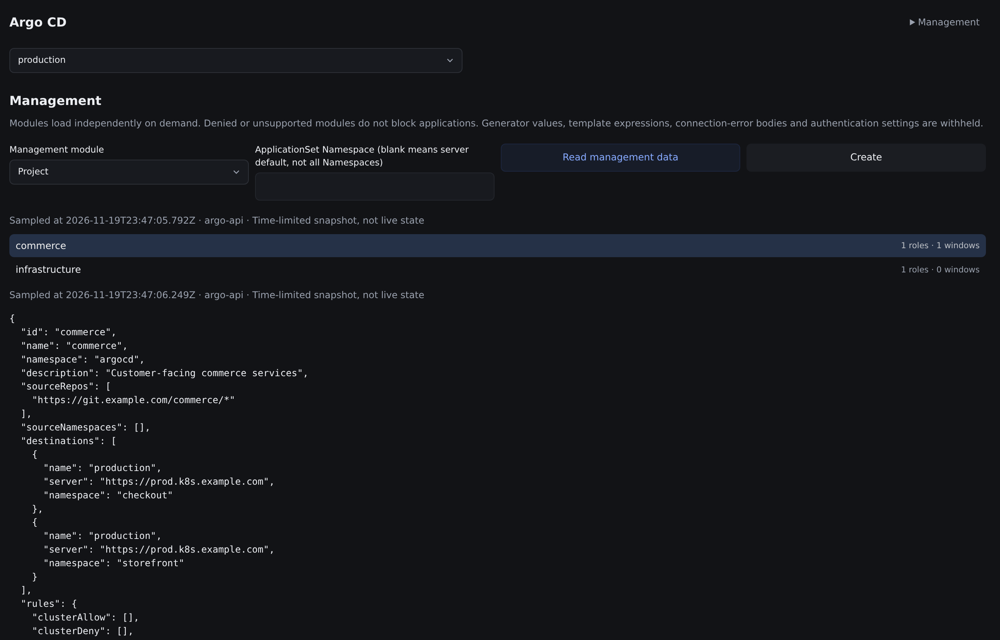

# OpenChamber Argo CD Observer

[English](../README.md) | 简体中文 | [العربية](README.ar.md) | [Deutsch](README.de.md) | [Español](README.es.md) | [Français](README.fr.md) | [עברית](README.he.md) | [日本語](README.ja.md) | [한국어](README.ko.md) | [Nederlands](README.nl.md) | [Polski](README.pl.md) | [Português (Brasil)](README.pt-BR.md) | [Türkçe](README.tr.md) | [Українська](README.uk.md) | [繁體中文](README.zh-TW.md)

一个功能完整的 **OpenChamber Argo CD 扩展**。无需离开工作区，即可浏览应用、查看部署详情、读取资源日志和事件，并直接执行 Argo CD 运维操作（同步、刷新、终止、回滚、资源动作、修补、创建、删除及管理域操作）。

## 安装

1. 在 OpenChamber 中打开 **设置 → 扩展**。
2. 在 **文件夹、ZIP 或 URL** 输入框中粘贴以下仓库地址，点击 **添加**：

   ```text
   https://github.com/hlhr202/OpenChamber-ArgoCD
   ```

3. 确认所请求的 Service 能力，选择 **允许并启用**。
4. 从扩展栏打开 **Argo CD**，加载已有 contexts。

无需本地构建或安装依赖。

也可从 [Releases](https://github.com/hlhr202/OpenChamber-ArgoCD/releases/latest) 下载 **openchamber-argocd.zip**，在扩展设置中添加该 ZIP。请选择附件中的预构建包，而非 GitHub 自动生成的 **Source code (zip)**。

## 前置条件

- **支持扩展的 OpenChamber**：扩展功能从 [v1.24.0](https://github.com/openchamber/openchamber/releases/tag/v1.24.0) 引入。本构建当前声明的安装下限为 **v2.2.0**，更早版本的兼容性尚未验证。
- **已安装并配置 Argo CD CLI**：运行 OpenChamber Server 的系统用户需已有有效凭据，并具备所需读写操作的 Argo CD RBAC 权限。扩展直接读取现有配置并调用 Argo CD 官方 REST API，不执行 CLI 二进制，也无需单独登录。
- OpenChamber Server 能访问所配置的 Argo CD API。

## 截图

英文界面，使用示例数据。

| 应用概览与操作栏 | 应用 Sync 弹窗 |
| :---: | :---: |
|  |  |
| **资源树与资源操作** | **管理视图（Project / Cluster / Repository / ApplicationSet）** |
|  |  |

## 功能

- 切换 Argo CD context，搜索和筛选应用。
- 查看应用配置、运行状态、部署历史和资源树。
- 读取 Pod／容器日志、事件、Manifest 和 Diff。
- 执行与官方 [Argo CD CLI](https://github.com/argoproj/argo-cd) 一致的运维操作（默认启用，受 Argo CD RBAC 与同步窗口管控）：同步（支持 Prune、Dry-Run、Force、Replace、Server-Side Apply、指定资源同步）、刷新／强制刷新、终止操作、回滚、资源动作（V2 及自动 V1 回退）、修补、创建／删除应用与资源，以及 ApplicationSet／Project／仓库／集群管理操作。
- 预览排障摘要，并确认后添加到聊天。
- 跟随 OpenChamber 的语言和主题，内置 15 种语言。

## 隐私

- 本扩展不采集个人隐私信息，也不向开发者上报私密数据；不包含遥测、行为分析或追踪。
- 仅为访问你配置的 Argo CD API 而读取已有本地凭据，不会将凭据、应用数据、日志或事件上传至开发者或第三方的数据采集服务。
- 浏览偏好（目录、context、应用／资源标识、应用筛选、页签和布局）保存于 OpenChamber 存储：支持时保存在当前设备，否则保存在所连接的 Server。不会在其中保存凭据、查询结果、日志／事件正文或摘要预览。恢复选择后重新查询数据，日志跟随不会自动恢复。
- 将摘要加入聊天需由你明确预览并确认；若随后发送，该内容由 OpenChamber 和你选择的模型服务商按各自政策处理。

本声明仅适用于本扩展，不代表 OpenChamber、Argo CD 或模型服务商的数据处理政策。

## 许可证

[MIT](../LICENSE)。捆绑依赖和 Argo 图标保留各自的许可证，详见[第三方许可证通知](../THIRD_PARTY_NOTICES.txt)。
